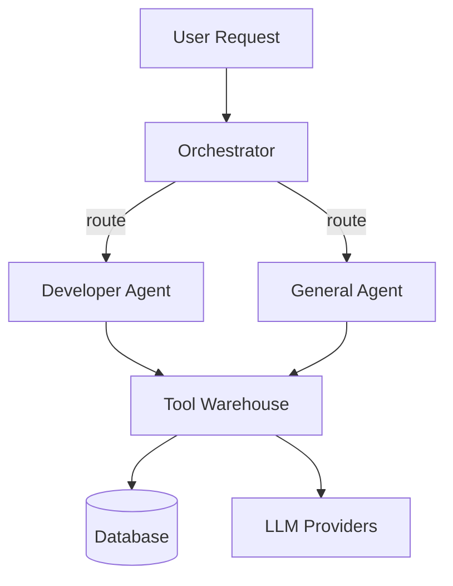
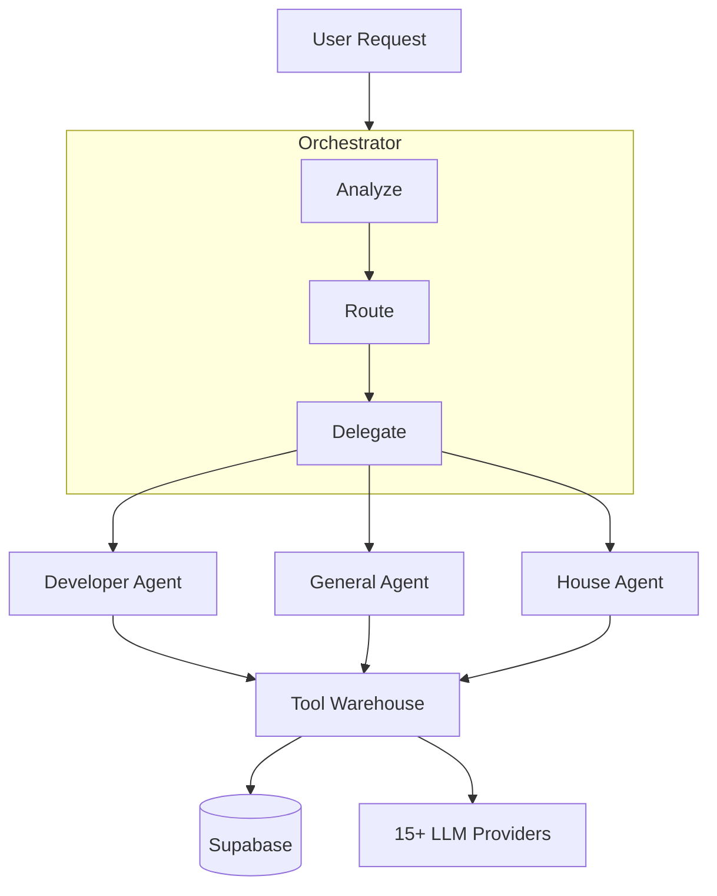

# README.md Quick Guide

The golden standard for portfolio project READMEs.

---

## Table of Contents

1. [Header](#1-header)
2. [One-Liner](#2-one-liner)
3. [Badges](#3-badges)
4. [Hero Image/Demo](#4-hero-imagedemo)
5. [Why I Built This](#5-why-i-built-this)
6. [Architecture](#6-architecture)
7. [Features](#7-features)
8. [Tech Stack](#8-tech-stack)
9. [Quick Start](#9-quick-start)
10. [Project Structure](#10-project-structure)
11. [Configuration](#11-configuration)
12. [API Reference](#12-api-reference)
13. [Contributing](#13-contributing)
14. [License](#14-license)

---

## 1. Header

**What:** Project name + logo (if any)

**Why:** First thing people see. Must be clear and memorable.

**Rules:**
- One line, big font
- Optional: logo or icon
- No fluff

**Example:**
```markdown
# Stark
```

---

## 2. One-Liner

**What:** Single sentence explaining what the project does

**Why:** People decide in 5 seconds if they want to read more

**Rules:**
- One sentence max
- No jargon
- Focus on WHAT it does, not HOW

**Example:**
```markdown
A multi-agent AI orchestration system that delegates tasks to specialized agents.
```

---

## 3. Badges

**What:** Small icons showing status/info

**Why:** Quick visual info (build status, license, version)

**Rules:**
- 3-4 functional badges max
- No vanity badge walls
- Use shields.io

**Example:**
```markdown


```

---

## 4. Hero Image/Demo

**What:** GIF, video, or screenshot showing the project in action

**Why:** #1 conversion factor. People want to SEE it work.

**Rules:**
- GIF under 5MB
- Show core functionality
- No setup screens, show the actual usage

**Example:**
```markdown

```

---

## 5. Why I Built This

**What:** 2-3 sentences explaining the problem you solved

**Why:** Shows you understand WHY, not just WHAT. Interviewers love this.

**Rules:**
- Problem → Solution format
- Keep it short (2-3 sentences max)
- Be specific

**Example:**
```markdown
## Why I Built This

Existing chatbots only answer questions. I wanted a system that can actually DO things - check databases, generate reports, control smart home devices. Stark doesn't just talk, it acts.
```

---

## 6. Architecture

**What:** Visual diagram showing how the system is built

**Why:** Shows system thinking. Most applicants skip this.

**Rules:**
- Use Mermaid (renders in GitHub)
- Show key components and data flow
- Add brief explanation of key decisions

**Example:**
```markdown
## Architecture



**Key decisions:**
- 3-tier hierarchy: Orchestrator → Workspace Agents → Subagents
- Tool Warehouse pattern: tools registered once, assigned by scope
- LLM proxy for billing control
```

---

## 7. Features

**What:** Bullet list of what the project can do

**Why:** Quick scan for capabilities

**Rules:**
- Bullet points
- Start with verb (Check, Generate, Deploy)
- 5-8 features max

**Example:**
```markdown
## Features

- Multi-agent orchestration with automatic task routing
- 60+ tools across coding, research, smart home, and business
- 15+ LLM providers with automatic fallback
- Voice input/output with real-time STT/TTS
- Telegram bot integration
- Electron desktop application
- Multitenant architecture for multiple clients
```

---

## 8. Tech Stack

**What:** Technologies used with icons/badges

**Why:** Shows technical breadth at a glance

**Rules:**
- Use icons/logos
- Group by category (Backend, Frontend, AI, etc.)
- Don't list every single library

**Example:**
```markdown
## Tech Stack

| Category | Technologies |
|----------|-------------|
| Backend | Python, FastAPI, Pydantic AI |
| Frontend | React, TypeScript, Electron |
| Database | SQLite, Supabase |
| AI/ML | LLM agents, OpenAI, Local LLMs |
| Voice | Moonshine STT, Pocket TTS |
```

---

## 9. Quick Start

**What:** Copy-paste commands to get running

**Why:** Shows you can document. People should be able to run your project.

**Rules:**
- Exact commands (copy-pasteable)
- Include prerequisites
- Under 5 steps

**Example:**
```markdown
## Quick Start

```bash
# Clone
git clone https://github.com/username/project.git
cd project

# Install
pip install -r requirements.txt

# Run
python main.py
```

**Prerequisites:** Python 3.11+, Node.js 18+
```

---

## 10. Project Structure

**What:** Directory tree showing file organization

**Why:** Shows code organization skills

**Rules:**
- Only show top 2-3 levels
- Brief comment for key folders
- Don't dump entire file tree

**Example:**
```markdown
## Project Structure

```
stark/
├── agents/           # Agent definitions
│   ├── orchestrator.py
│   ├── developer.py
│   └── general.py
├── tools/            # Tool implementations
├── llm/              # LLM provider configs
├── memory/           # Memory systems
├── frontend/         # Electron app
└── config/           # Configuration files
```
```

---

## 11. Configuration

**What:** How to configure the project

**Why:** Shows production thinking

**Rules:**
- Show required env vars
- Show config file format
- Keep it simple

**Example:**
```markdown
## Configuration

Create `.env` file:

```env
OPENAI_API_KEY=your-key-here
DATABASE_URL=sqlite:///data.db
```
```

---

## 12. API Reference

**What:** Endpoints/functions documentation

**Why:** If your project has an API, document it

**Rules:**
- Only if project has API
- Show endpoint + method + description
- Keep it brief

**Example:**
```markdown
## API Reference

| Method | Endpoint | Description |
|--------|----------|-------------|
| POST | /chat | Send message to agent |
| GET | /status | Get system status |
```

---

## 13. Contributing

**What:** How others can contribute

**Why:** Shows open-source awareness

**Rules:**
- Link to CONTRIBUTING.md
- Or keep it brief

**Example:**
```markdown
## Contributing

Contributions welcome! Please read [CONTRIBUTING.md](CONTRIBUTING.md) first.
```

---

## 14. License

**What:** Legal usage rights

**Why:** Professional standard

**Rules:**
- MIT is most common
- Link to LICENSE file

**Example:**
```markdown
## License

MIT License - see [LICENSE](LICENSE) for details
```

---

## Full Example

Here's a complete README example for a project like Stark:

---

```markdown
# Stark

A multi-agent AI orchestration system that delegates tasks to specialized agents.


## Why I Built This

Most AI chatbots just answer questions. I wanted a system that actually DOES things - writes code, manages files, controls smart home, handles business tasks. Stark doesn't just talk, it acts.

## Architecture



**Key decisions:**
- 3-tier hierarchy for separation of concerns
- Tool Warehouse pattern: tools registered once, assigned by scope
- LLM proxy for billing control and provider rotation

## Features

- Multi-agent orchestration with automatic task routing
- 60+ tools across coding, research, smart home, and business
- 15+ LLM providers with automatic fallback
- Voice input/output with real-time STT/TTS
- Telegram bot integration
- Electron desktop application
- Context compaction for long conversations
- Crash recovery and session persistence

## Tech Stack

| Category | Technologies |
|----------|-------------|
| Backend | Python 3.11, FastAPI, Pydantic AI |
| Frontend | React 19, TypeScript, Electron |
| Database | SQLite (mmap), Supabase |
| AI/ML | Pydantic AI, Pydantic Graph, FastEmbed |
| Voice | Moonshine STT, Pocket TTS |

## Quick Start

```bash
# Clone
git clone https://github.com/username/stark.git
cd stark

# Install
pip install -r requirements.txt

# Configure
cp .env.example .env
# Edit .env with your API keys

# Run
python main.py
```

**Prerequisites:** Python 3.11+, Node.js 18+ (for frontend)

## Project Structure

```
stark/
├── agents/              # Agent definitions
│   ├── orchestrator.py  # Main orchestrator
│   ├── developer.py     # Coding agent
│   ├── general.py       # Research agent
│   └── house.py         # Smart home agent
├── tools/               # 60+ tool implementations
├── llm/                 # LLM provider configs
├── memory/              # Memory and context systems
├── frontend/            # Electron desktop app
├── Telegram/            # Telegram bot
├── Voice/               # STT/TTS systems
└── config/              # Configuration files
```

## Configuration

Create `.env` file:

```env
# LLM Providers (at least one required)
OPENAI_API_KEY=your-key
GROQ_API_KEY=your-key

# Database
DATABASE_URL=sqlite:///data.db

# Optional
TELEGRAM_BOT_TOKEN=your-token
```

## License

MIT License - see [LICENSE](LICENSE) for details
```

---

## Checklist

Before publishing your README, verify:

- [ ] One-liner is clear and jargon-free
- [ ] Demo GIF/video is under 5MB
- [ ] Architecture diagram renders correctly
- [ ] Quick Start commands work (copy-paste test)
- [ ] Badges are functional (not vanity)
- [ ] No spelling/grammar errors
- [ ] Links work
- [ ] Under 1500 words total
